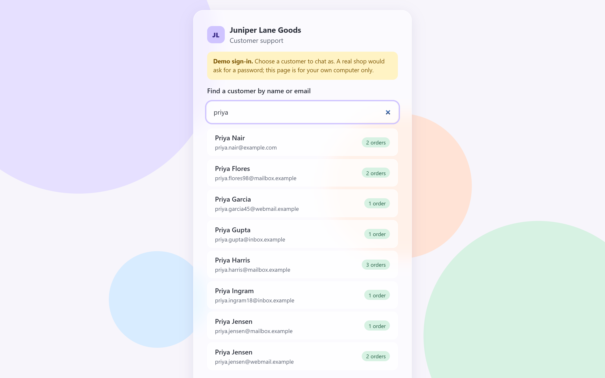
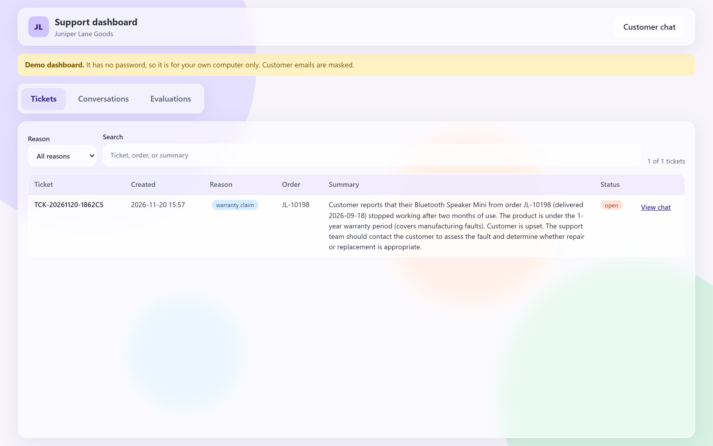
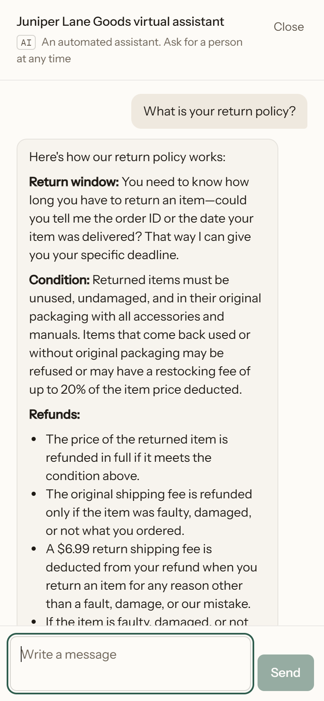

# Customer Support Agent Harness

An AI customer support assistant for **Juniper Lane Goods**, a fictional online
shop. A customer asks a question in a chat, and the assistant looks up the
answer in the shop's own documents and the customer's orders, then replies. When
it can't help safely, it hands the conversation to a human by creating a support
ticket.

The assistant answers only from the shop's information. It never makes up
policies, prices, or order details, and it never shows one customer another
customer's data.

<p align="center">
  
</p>

## Features

- **Customer chat:** answers questions about orders, shipping, returns,
  refunds, and warranties.
- **Order look-up:** customers can see their own orders only.
- **Hand-over to a human:** the assistant creates a support ticket for refunds,
  returns, upset customers, questions it can't answer, and anyone who asks for
  a person.
- **Built-in safety checks:** every reply is checked before the customer sees
  it, to catch made-up figures, refund promises, and other customers' details.
- **Behind-the-scenes panel:** shows what the assistant did for each reply,
  including which tools it used and the time and cost.
- **Support dashboard:** lists every ticket and lets staff replay any
  conversation step by step.
- **Private logs:** every step is recorded, with emails, phone numbers, and
  addresses hidden.
- **Terminal chat:** you can also chat with the assistant from the command line.
- **Works on phones:** the web app adapts to small screens.

## Screenshots

<table>
  <tr>
    <td align="center" width="50%">
      <br>
      <sub>Pick a sample customer to chat as</sub>
    </td>
    <td align="center" width="50%">
      <br>
      <sub>Support dashboard with every ticket</sub>
    </td>
  </tr>
  <tr>
    <td align="center" colspan="2">
      <br>
      <sub>Replay of a past conversation</sub>
    </td>
  </tr>
</table>

<p align="center">
  <br>
  <sub>The chat on a phone</sub>
</p>

## How to run it

You need **Python 3.10 or newer**, **Node.js 20 or newer**, and an **AWS account
with access to Amazon Bedrock**.

**1. Download the project and install it**

```bash
git clone https://github.com/DARSHAN120806/customer-support-agent-harness.git
cd customer-support-agent-harness
python -m venv .venv
.venv/Scripts/python -m pip install -e ".[web]"      # Windows
# .venv/bin/python -m pip install -e ".[web]"        # macOS / Linux
npm --prefix frontend install
```

**2. Add your keys**

Copy `.env.example` to a new file called `.env`, then fill in your AWS region
and Bedrock API key. The `.env` file stays on your computer and is never shared.

**3. Start the app**

Open two terminals in the project folder. In the first, start the server:

```bash
.venv/Scripts/python -m uvicorn support_agent.web.api:create_app --factory --port 8000
```

In the second, start the web page:

```bash
npm --prefix frontend run dev
```

Then open:

- **Chat:** http://localhost:5173
- **Support dashboard:** http://localhost:5173/#/dashboard

**Or chat in the terminal instead**

```bash
.venv/Scripts/python -m support_agent --email priya.nair@example.com
```

**Things to try** (as the sample customer Priya Nair)

- `What is your return policy?`
- `Is my speaker from JL-10198 still under warranty?`
- `I want a refund for the coffee set in JL-10231.`
- `Can I speak to a human?`

> **Note:** the sign-in is a demo. Anyone can pick any customer, and the
> dashboard has no password. Run it only on your own computer.

## Built with

Python · FastAPI · Claude on Amazon Bedrock · Amazon Titan embeddings ·
React · TypeScript · Vite

## Disclaimer

Juniper Lane Goods is fictional. All customers, orders, and emails in this
project are made up.
