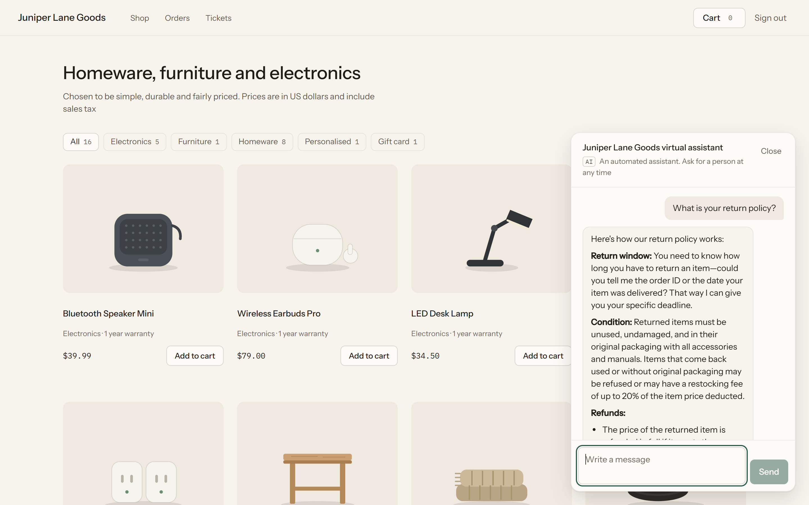
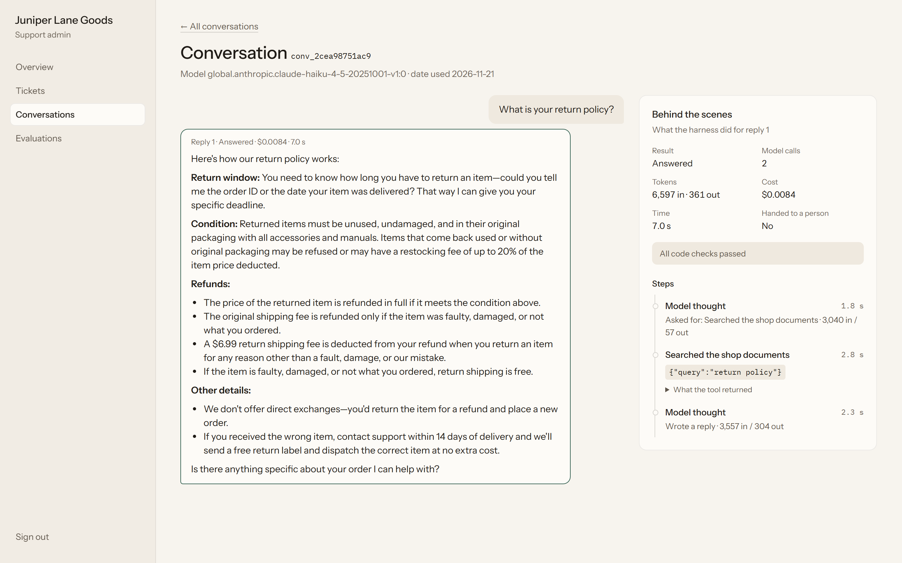

# Customer Support Agent Harness

An AI customer support assistant for **Juniper Lane Goods**, a fictional online
shop. A customer asks a question in a chat, and the assistant looks up the
answer in the shop's own documents and the customer's orders, then replies. When
it can't help safely, it hands the conversation to a human by creating a support
ticket.

The assistant answers only from the shop's information. It never makes up
policies, prices, or order details, and it never shows one customer another
customer's data.

## Features

- **Support chat:** a "Chat with us" button at the bottom right of the shop
  opens the assistant, which answers questions about orders, shipping, returns,
  refunds, and warranties.
- **Sign-in with passwords:** customers sign in with their email and password;
  the shop's admin signs in to a separate dashboard.
- **Shop page:** after signing in, customers see the shop's products with
  prices and stock, can fill a cart (checkout is switched off: nothing can be
  bought), and see their own orders and support tickets.
- **Order look-up:** customers can see their own orders only.
- **Hand-over to a human:** the assistant creates a support ticket for refunds,
  returns, upset customers, questions it can't answer, and anyone who asks for
  a person.
- **Built-in safety checks:** every reply is checked before the customer sees
  it, to catch made-up figures, refund promises, and other customers' details.
- **Admin panel:** an overview of conversations, hand-overs, reply time, cost
  and the safety checks that fired; every ticket; and a step-by-step replay of
  any conversation showing what happened behind the scenes for each reply.
  Customers never see these details.
- **Edit the shop documents in the admin panel:** change the shipping, returns,
  refunds, warranty and FAQ texts, prices and stock. Each save is checked (no
  customer details, sections short enough for the search, the product table
  still readable), the search is updated straight away, and every earlier
  version can be viewed and restored. Nothing needs to be "trained".
- **Look up any order in the admin panel:** search by order ID, customer or
  item and see everything on it, from tracking to refunds and past tickets.
- **Choose the model in the admin panel:** switch between Amazon Bedrock, the
  Anthropic API, or any OpenAI-compatible service (OpenAI, OpenRouter, Groq),
  including **local models through Ollama or LM Studio**. Test the connection
  first, then save; new chats use the new model. The document search model can
  be switched the same way, so the shop can run fully on your own computer.
- **Private logs:** every step is recorded, with emails, phone numbers, and
  addresses hidden.
- **Terminal chat:** you can also chat with the assistant from the command line.
- **Works on phones:** the web app adapts to small screens.

## Screenshots

<p align="center">
  <br>
  <sub>The support chat on the shop page, answering from the shop's own return policy</sub>
</p>

<p align="center">
  <br>
  <sub>The admin panel: a replayed conversation, with each step the assistant took,
  the tools it used, the checks it passed, and the time and cost</sub>
</p>

<p align="center">
  <br>
  <sub>The same chat on a phone</sub>
</p>

## How to run it

You need **Python 3.10 or newer**, **Node.js 20 or newer**, and an **AWS account
with access to Amazon Bedrock**.

**1. Download the project and install it**

```bash
git clone https://github.com/DARSHAN120806/customer-support-agent-harness.git
cd customer-support-agent-harness
python -m venv .venv
.venv/Scripts/python -m pip install -e ".[web]"      # Windows
# .venv/bin/python -m pip install -e ".[web]"        # macOS / Linux
npm --prefix frontend install
```

**2. Add your keys**

Copy `.env.example` to a new file called `.env`, then fill in your AWS region
and Bedrock API key. The `.env` file stays on your computer and is never shared.

**3. Create the test passwords**

```bash
.venv/Scripts/python scripts/create_test_passwords.py
```

This gives every sample customer, and one admin account, a random password.
They are listed in `private/test_passwords.csv`, which stays on your computer.
The app itself stores passwords only in scrambled (hashed) form.

**4. Start the app**

Open two terminals in the project folder. In the first, start the server:

```bash
.venv/Scripts/python -m uvicorn support_agent.web.api:create_app --factory --port 8000
```

In the second, start the web page:

```bash
npm --prefix frontend run dev
```

Then open http://localhost:5173 and sign in with an email and password from
`private/test_passwords.csv`. Customers go to the shop page, where **Chat with
us** at the bottom right opens the chat. The admin account (`admin@juniperlane.example`) goes to the
support dashboard.

**Using a different model**

Sign in as the admin and open **Model** in the sidebar. To use a local model,
install [Ollama](https://ollama.com), download a model that can use tools (for
example `ollama pull llama3.1`), then choose **OpenAI-compatible**, click
**Ollama**, type the model name and press **Test connection**. Smaller local
models are often weaker at using tools, and the test tells you if a model
cannot.

**Or chat in the terminal instead**

```bash
.venv/Scripts/python -m support_agent --email priya.nair@example.com
```

**Things to try** (signed in as the sample customer Priya Nair)

- `What is your return policy?`
- `Is my speaker from JL-10198 still under warranty?`
- `I want a refund for the coffee set in JL-10231.`
- `Can I speak to a human?`

> **Note:** this is for running on your own computer. It has no HTTPS or
> password reset yet, so don't put it on the internet as it is.

## Built with

Python · FastAPI · Claude on Amazon Bedrock · Amazon Titan embeddings ·
React · TypeScript · Vite

## Disclaimer

Juniper Lane Goods is fictional. All customers, orders, and emails in this
project are made up.
