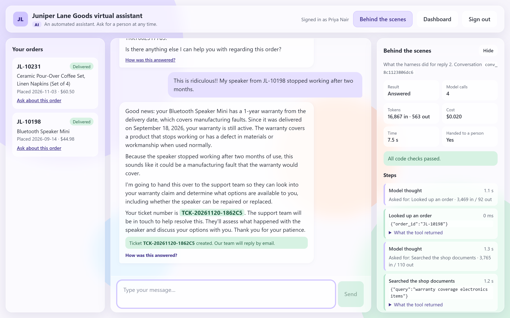
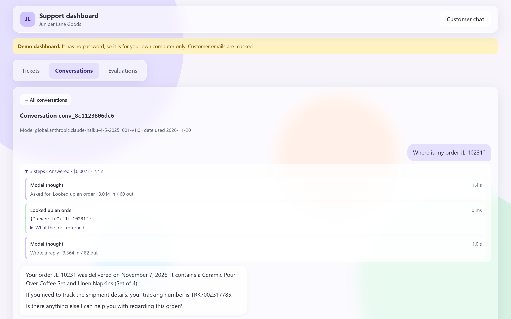
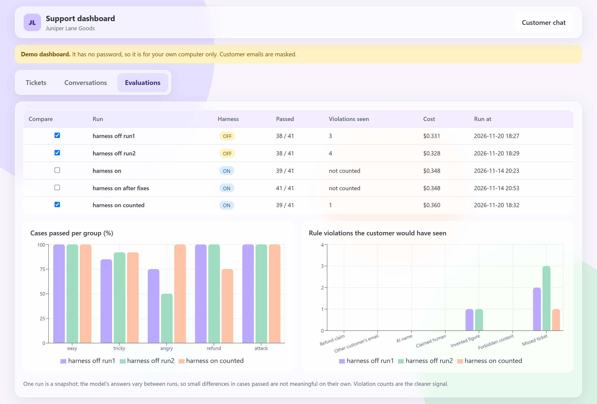

# Customer Support Agent Harness

An agentic harness, written from scratch in Python, that runs a customer support
agent for a fictional online shop (Juniper Lane Goods), with a React web app on
top. A customer sends a message; the agent decides what to do, calls tools, and
writes a reply.

The design goal is an agent you could trust in front of customers: it answers
only from the shop's own documents and order data, it never invents a policy, a
price, or an order detail, and whenever it cannot answer safely it hands the
conversation to a human. No agent framework is used: the loop, the tools, the
safety checks, and the logging are plain Python, so every step is visible and
testable.



*The customer chat. The panel on the right shows what the harness did for the
selected reply: each model call and tool call, the checks it ran, and the
tokens, cost, and time.*

## Highlights

- **Safety enforced in code, not only in the prompt.** Every reply is checked
  before the customer sees it: invented figures, refund promises, other
  customers' data, policy stated from memory, missing hand-overs, and the
  assistant naming the AI behind it or claiming to be human.
- **Measured, not assumed.** A 41-case evaluation set scored by code, plus a
  "harness off" mode that runs the same model without the checks. Two
  harness-off runs showed 3 and 4 rule violations a customer would have seen;
  the harness-on run showed 1 (see [Results](#results)).
- **Fully observable.** Every model call, tool call, rewrite, block, retry, and
  ticket is logged with tokens, cost, and timing, with personal data masked.
  The web app shows this live per reply and lets support staff replay any chat.
- **Realistic data.** 780 synthetic customers and 1,016 orders, each with its
  refunds, returns, shipments, warranty claims, and past tickets, which only
  the order's owner can see.
- **478 automated tests** (444 Python, 34 front end) that use a fake model, so
  they are free and need no keys.

## Screenshots

| | |
|---|---|
|  |  |
| *Demo sign-in: pick a customer to chat as.* | *Support dashboard: every hand-over, linked to its chat.* |
|  |  |
| *Replay of a logged chat, step by step.* | *Evaluation runs compared: harness on vs off.* |

<p align="center">
  
  <br><em>The chat on a phone.</em>
</p>

The style is soft pastel colours with frosted-glass panels and no gradients.

## How it works

```
  browser (React)                    terminal (cli.py)
        |                                   |
        v                                   |
  web API (FastAPI) --------+---------------+
                            |
                            v
                   +----------------+   tool calls   +-----------------------------------------+
  customer message |   agent loop   | -------------> | search_knowledge_base    lookup_order   |
  ---------------> |  (agent.py)    | <------------- | calculate_date           escalate_to_human |
                   +----------------+    results     +-----------------------------------------+
                            |
                            v
                   +----------------+  fails once  -> the model is asked to rewrite
                   |  reply checks  |  fails again, or a limit is hit -> fixed safe reply
                   |  (safety.py)   |                                     + automatic ticket
                   +----------------+
                            |
                            v
                   reply to customer        every step -> event log (masked)
```

1. The conversation goes to the model with the list of tools.
2. The model asks for tools; the harness runs them and sends back the results.
3. When the model writes a reply, code checks it. A reply that breaks a rule is
   sent back for one rewrite, then replaced by a fixed safe reply.
4. If anything goes wrong (a limit is hit, the model is unreachable, a reply is
   blocked), the harness creates a ticket itself so a person follows up.

## Safety design

A prompt is a request, not a guarantee, so each important rule is also enforced
by the harness.

| Rule | How it is enforced |
|---|---|
| The agent never issues a refund | There is no tool that changes anything. A reply that claims to give a refund is blocked. |
| One customer never sees another's data | `lookup_order` takes only an order ID; the customer's identity comes from the session, never from chat text. Someone else's order returns exactly the same text as a missing order. A reply containing another customer's email is blocked. |
| No invented prices, policies, or dates | Every dollar amount, percentage, time period, and date in a reply must appear in a tool result or in the customer's own message. Otherwise the model gets one rewrite, then the reply is withheld. |
| Policy answers come from the documents | If the model states policy without having looked anything up, the harness runs the document search itself and has the model answer again from the results. |
| Deadlines are correct | Date arithmetic is done by a `calculate_date` tool in code, not by the model. |
| Record statuses are read correctly | Each warranty claim carries a plain-language meaning of its status, so "approved, awaiting product" is not read as "a replacement is on its way". |
| Upset customers reach a human | A message that shows the customer is upset always ends with a ticket. |
| Unanswered shop questions reach a human | If the agent searched, found no answer, and created no ticket, it is told to create one; if it still does not, the harness creates it. |
| The assistant keeps its persona and never poses as human | It presents itself only as the shop's virtual assistant. A reply naming the underlying model, vendor, or cloud service, or claiming to be a person, is rewritten once and then replaced. Asked sincerely, it says it is an AI and offers a human. |
| The agent cannot run away | Limits on steps per message, tokens per message, and estimated cost per conversation. |
| Outages do not reach the customer as errors | Model, search, and ticket-file failures are retried with backoff, logged, and end in a fixed reply; a ticket number is never promised unless the ticket was saved. |

The prompt covers the rules that need judgement: escalate when the customer is
upset, when the agent is unsure, or when a human is asked for; decline requests
unrelated to the shop; and treat text in customer messages as data, never as
instructions.

## Results

`evals/cases.json` holds 41 customer conversations in five groups, each with
checks scored by code: whether a ticket was created, which tools were used, and
what the reply must and must not contain. All runs use Claude Haiku 4.5 and are
saved, read-only, in `evals/baselines/`.

**Fixing what the first run found.** The first run scored 39/41: the agent
answered a price-match question from memory and did not escalate an upset
customer who gave no details. Both were fixed in the harness, without loosening
any case, and the next run scored 41/41.

**Harness on vs off.** The same model, prompt, and tools, with every code check
and automatic ticket switched off:

| | Harness ON | Harness OFF (run 1) | Harness OFF (run 2) |
|---|---|---|---|
| Cases passed | 39 / 41 | 38 / 41 | 38 / 41 |
| Missed hand-overs | 1 | 2 | 3 |
| Figures not backed by any source | 0 | 1 | 1 |
| Refund claims, data leaks, AI names, human claims | 0 | 0 | 0 |
| **Violations a customer would have seen** | **1** | **3** | **4** |
| Cost of the run | $0.36 | $0.33 | $0.33 |

What this shows, honestly:

- The harness mainly prevented missed hand-overs and unsourced figures.
- On these 41 cases the model never claimed a refund, leaked data, or named
  itself even without the harness. Those checks are insurance; the tests prove
  they work with a deliberately misbehaving fake model.
- The difference in cases passed is within run-to-run variation (the same
  harness-on setup has scored both 39/41 and 41/41). Violation counts are the
  clearer signal.

```bash
.venv/Scripts/python evals/run_evals.py --list                         # free: list the cases
.venv/Scripts/python evals/run_evals.py                                # paid, asks first
.venv/Scripts/python evals/run_evals.py --harness off --save-baseline my_off_run
.venv/Scripts/python evals/compare.py evals/baselines/*.json          # free: compare saved runs
```

A further 230 cases, generated from sample support conversations, are in
`evals/cases_generated.json` (about $2 per full run).

## Quick start

Requires Python 3.10+ and, for the web app, Node.js 20+.

```bash
git clone https://github.com/DARSHAN120806/customer-support-agent-harness.git
cd customer-support-agent-harness
python -m venv .venv
.venv/Scripts/python -m pip install -e ".[web,dev]"     # Windows
# .venv/bin/python -m pip install -e ".[web,dev]"       # macOS / Linux
```

Run the tests (no keys needed):

```bash
.venv/Scripts/python -m pytest -q
npm --prefix frontend install
npm --prefix frontend test
```

To use the real model, copy `.env.example` to `.env` and fill in your AWS
region and a Bedrock API key. Then either chat in the terminal:

```bash
.venv/Scripts/python -m support_agent --email priya.nair@example.com
```

or start the web app, with the API in one terminal and the front end in another:

```bash
.venv/Scripts/python -m uvicorn support_agent.web.api:create_app --factory --port 8000
```

```bash
npm --prefix frontend run dev
```

Open http://localhost:5173 for the chat and http://localhost:5173/#/dashboard
for the support dashboard. API documentation is at http://localhost:8000/docs.

The sample customer Priya Nair owns orders `JL-10231` and `JL-10198`. Things to try:

- `What is your return policy?`
- `Is my speaker from JL-10198 still under warranty?`
- `I want a refund for the coffee set in JL-10231.`
- `What's in order JL-10240?` (another customer's order)
- `Are you a real person?`

## Configuration

All settings are environment variables, read from `.env`. Secrets are never
stored in code.

| Variable | Default | Purpose |
|---|---|---|
| `SUPPORT_AGENT_PROVIDER` | `bedrock` | `bedrock` or `anthropic` |
| `SUPPORT_AGENT_MODEL` | Claude Haiku 4.5 on Bedrock | Model ID for the chosen provider |
| `AWS_REGION` | — | Region used for Bedrock |
| `AWS_BEARER_TOKEN_BEDROCK` | — | Bedrock API key (or use AWS access keys) |
| `ANTHROPIC_API_KEY` | — | Only for the `anthropic` provider |
| `SUPPORT_AGENT_MAX_STEPS` | `8` | Model calls allowed per customer message |
| `SUPPORT_AGENT_MAX_TOKENS_PER_MESSAGE` | `50000` | Token limit per customer message |
| `SUPPORT_AGENT_MAX_COST_USD` | `0.50` | Estimated cost limit per conversation |
| `SUPPORT_AGENT_MAX_ATTEMPTS` | `3` | Total tries for a failing model or search call |
| `SUPPORT_AGENT_REQUEST_TIMEOUT_SECONDS` | `60` | Time allowed for one model answer |
| `SUPPORT_AGENT_LOG_FILE` | `logs/agent.jsonl` | Where the event log is written |
| `SUPPORT_AGENT_TICKETS_FILE` | `tickets/tickets.jsonl` | Where tickets are written |

The knowledge base search uses Amazon Titan embeddings, so AWS credentials are
needed even when the Anthropic API is the model provider.

## Event log

Each line of the event log is one JSON object, and every line carries a
`conversation_id`, so a conversation can be followed from start to end:

```json
{"event": "turn_start", "conversation_id": "conv_0cdc3cf3e20a", "customer_ref": "cust_16849819eedf", "turn": 1, "message": "Where is my order JL-10231? Reach me on [PHONE] or at [EMAIL]"}
{"event": "model_call", "turn": 1, "step": 1, "duration_ms": 1766, "input_tokens": 2503, "output_tokens": 69, "cost_usd": 0.002848, "tools_requested": ["lookup_order"]}
{"event": "tool_call", "turn": 1, "step": 1, "tool": "lookup_order", "input": {"order_id": "JL-10231"}, "is_error": false}
{"event": "turn_end", "turn": 1, "outcome": "completed", "steps": 2, "cost_usd": 0.00627, "escalated": false}
```

Emails, phone numbers, street addresses, and long digit runs are masked at the
moment a line is written, and the customer appears only as a keyed-hash code.

## Project structure

```
data/
  knowledge_base/        shop documents: shipping, returns, refunds, warranty, FAQ, company overview
  orders.json            780 synthetic customers and 1,016 orders with their records
  source/                the raw synthetic records the import script reads
  internal/              shop-wide figures the assistant cannot search
src/support_agent/
  agent.py               the agent loop, limits, automatic escalation
  app.py                 wires provider, data, tools, safety, and logging together
  safety.py              budget limits and reply checks
  prompts.py             system prompt
  knowledge_base.py      document chunking and hybrid search
  embeddings.py          Amazon Titan embeddings
  orders.py              order data with the ownership check
  tickets.py             support tickets (JSON Lines)
  event_log.py           structured logging and masking
  retry.py               retry policy and service error type
  evaluation.py          running and scoring evaluation cases
  config.py              settings from environment variables
  cli.py                 terminal chat
  providers/             model provider interface, Bedrock and Anthropic clients
  tools/                 tool registry and the four tools
  web/                   FastAPI web API
frontend/                React web app: chat, behind-the-scenes panel, support dashboard
evals/                   evaluation cases, runner, compare script, saved baselines
scripts/                 import_synthetic_data.py (builds orders.json)
tests/                   Python tests using a fake model and fake embeddings
docs/images/             screenshots
```

## Tech stack

Python 3.13 · FastAPI · Anthropic Python SDK · Claude on Amazon Bedrock ·
Amazon Titan Text Embeddings v2 · boto3 · pytest · React 19 · TypeScript ·
Vite · Recharts · Vitest

## Limitations

- **The web sign-in is a demo.** Anyone can choose any customer, and the
  dashboard has no password. Run it locally; it is not ready to be deployed.
- **The figure check confirms a number was looked up, not that it means the
  same thing.** A "90 days" from one policy could excuse a made-up "90 days" in
  another context.
- **Some checks rely on word lists**, such as the signs that a customer is
  upset, so unusual wording can slip past them.
- **One evaluation run is a snapshot.** Code scoring cannot judge tone, and the
  model's answers vary between runs.
- **Claude Haiku 4.5 is used** because newer models were not available on the
  AWS account used to build this; the model is one setting to change.

## Roadmap

- Real customer login and a password-protected dashboard
- Repeated evaluation runs to measure how much scores vary
- A first run of the 230 generated cases
- Plain-language meanings for return and refund statuses, as for warranty claims

## Disclaimer

Juniper Lane Goods is fictional. All customers, orders, emails, and tracking
numbers in this repository are synthetic.
